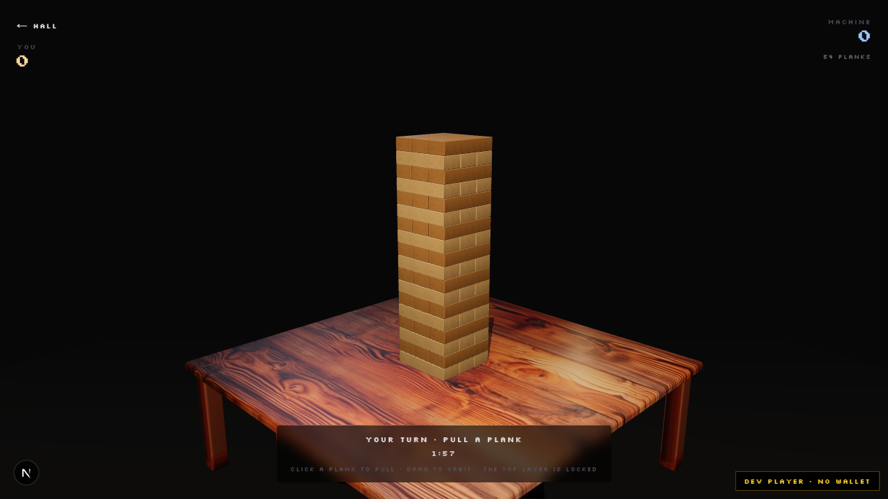

# SolAde Games

> A skill arcade of three machines, built to run on Bankroll's rails.



---

## 1. What this is

SolAde Games is **content**: three deterministic skill games, presented as a walkable
arcade hall. It is built to be a title that launches on **Bankroll**, using their
payments, age checks and matchmaking rather than carrying any of that ourselves.

**What we are not:**

- Not a competing payments platform.
- Not a token, and not a platform rake. We take **no cut of game revenue**.
- Not an NFT sale. There is no machine mint, no holder pool, no whitelist.

The arcade wins when players keep playing. That only works if the money rails are
someone else's job, run by someone with the licences for it.

> **A note on earlier drafts.** This document used to describe an arcade on Arc
> Testnet with its own USDC rails, a 25% NFT holder share and a 15% platform take.
> That plan is retired, and so is the Arc Testnet claim. What follows describes the
> product as it exists today.

---

## 2. The three machines

All three are playable now, in the browser, at the routes below.

| Machine | Route | What it is |
|---|---|---|
| **Stack Tower** | `/games/stack-tower` | Pull a plank from the tower and place it on top. Real physics, a real opponent. |
| **Brick Blitz** | `/games/brick-blitz` | Brick breaker on a billiard table. Six materials, each with its own hit, sound and score. |
| **Neon Pinball** | `/games/pinball` | A full pinball table: flippers, bumpers, slingshots, a plunger, and bells in A minor pentatonic. |

Each machine has its own 3D scene, its own synthesised or recorded sound design,
and its own rules. They are not reskins of one game.

**Also present:** a daily puzzle at `/play`, with server-side answer checking. It is
gated behind a player handle, so it is not playable for a first-time visitor.

**Not present:** Bubble Pop. It existed in an earlier scope and is not in this code.

---

## 3. What is live today, precisely

- The three cabinets, free to play, no wallet required to start.
- The hall: a 3D front door, a wooden bar, and three stations you click to enter.
- Wallet connect on **Solana devnet**, with a player profile and per-game bests.
- The daily puzzle and its API, gated behind a handle.

**What is not live:** any payment. No entry fees, no prize pools, no USDC movement,
no settlement. Devnet-only scripts for league settlement exist in `scripts/`, but
nothing is running and no funds move.

**On the chain question:** the wallet layer is Solana devnet, because that is the
client we built and tested. Settlement is deliberately unimplemented, pending the
decision below. There is no live USDC anywhere in this product.

---

## 4. Why the games are worth putting on your rails

- **Deterministic boards.** Every board, wall and table is generated from a fixed
  seed, so two players in the same round face the same machine. A score means
  something across wallets.
- **Physics, not animation.** Pinball runs a fixed-timestep rigid body simulation;
  Stack Tower uses real bodies, so a pull can genuinely topple the tower.
- **Sound that is played, not looped.** Material hits are triggered per contact,
  measured for onset and level on load.
- **A skill arcade is a content business.** The games are the product; they need a
  home with an audience, which is what Bankroll has and what we do not.

---

## 5. What we would need from Bankroll

| Capability | Why we are not doing it ourselves |
|---|---|
| **Payments and settlement** | Licensed, and we take no cut of game revenue. |
| **Age checks** | Required for paid play; we have no process for it. |
| **Matchmaking and lobbies** | Bankroll already has an audience to match against. |
| **Custody and payouts** | Someone with the compliance posture has to hold the money. |

## 6. What we bring

- Three finished, playable games with distinct mechanics.
- A presentation layer that makes them feel like a room rather than a menu: an
  entrance, a bar, three stations, a lit sign, ambient sound.
- A Next.js client, a small API surface, and an art pipeline (Blender scripts plus
  a PNG-to-3D route) that turns supplied artwork into 3D scene assets.

---

## 7. Open questions for Bankroll

These are the questions that decide what this becomes. None of them are answered
by code in this repository.

1. **Revenue split.** If Bankroll takes no cut of game revenue, where does the arcade's
   share come from, and who sets it?
2. **Settlement model.** Do you settle per round, per session, or per league, and in
   what asset?
3. **Age gating.** Is it per account, per jurisdiction, or per payment method?
4. **Matchmaking.** Do we hand you a queue request, or do you host the lobby and hand
   us a session?
5. **Custody.** Are player balances held by Bankroll and exposed to us as an API, or
   does the player sign each round?
6. **Porting.** Do you want the three games as-is, or a single title from this set as a
   first integration?

---

## 8. How the code is organised

```
web/                    Next.js 16 app (React 19, Tailwind 4)
  app/                  routes: hall, three games, puzzle, profile, docs
  components/games/     one component per machine, each self-contained
  components/hall/      the 3D entrance and room
  lib/                  per-game rules, physics glue and audio engines
  public/               models, textures, billboards, audio
art/                    Blender scripts that build the 3D scene assets
docs/                   design and state notes per cabinet
```

**Stack:** Next.js 16, React 19, three.js with react-three-fiber, Rapier for physics,
Web Audio for sound, Blender for scene assets.

**Build and run:**

```bash
cd web
npm install
cp .env.example .env.local   # database and devnet settings
npm run dev
```

The three games run entirely in the browser and need no backend. The account API
needs Postgres.

---

## 9. Status

| Area | State |
|---|---|
| Three cabinets | Playable, sound complete |
| Hall | Entrance, bar, three stations, sign |
| Wallet and profile | Solana devnet |
| Daily puzzle | Present, gated behind a handle |
| Payments | **Not implemented, by design** |
| NFT, token, holder share | **Retired** |

*SolAde Games, 13 November 2026. Prepared for review by Bankroll.*
