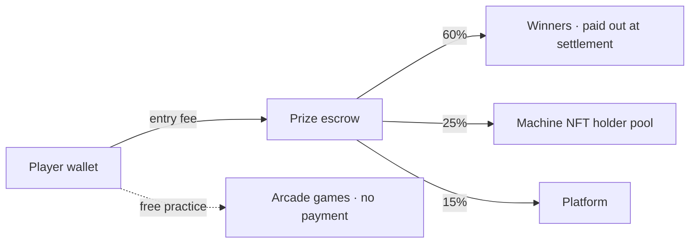
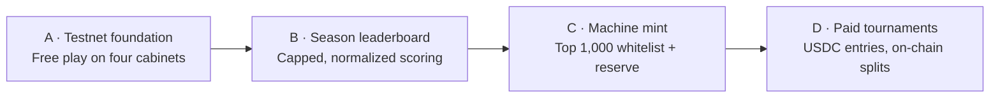

# ARC-ADE — Project Overview

> A skill arcade on Arc. Four deterministic cabinet games and a daily puzzle league.
> Practice free, compete in USDC, and own a machine of the hall.

---

## Contents

1. [The idea](#1-the-idea)
2. [The five game modes](#2-the-five-game-modes)
3. [Why the games are fair](#3-why-the-games-are-fair)
4. [How USDC moves](#4-how-usdc-moves)
5. [The machines](#5-the-machines)
6. [The game plan](#6-the-game-plan)
7. [What's live today](#7-whats-live-today)

---

## 1. The idea

Most "play-to-earn" games print a token and hope the token holds value. ARC-ADE
deliberately does the opposite:

- **No game token.** Every prize is USDC that another player actually paid in.
- **No emissions.** There is no inflation mechanism that can collapse.
- **Skill only.** Every board is generated from the UTC date, so all players face the
  identical machine. The only variables are your inputs and your timing.
- **Free practice, always.** Paid entry is optional and never gates the game itself.

The product is a **hall of arcade machines**. You walk in, pick a cabinet, and play.
If you want to compete for money, you put USDC on the round. If you get good enough, you
can end up owning one of the machines itself.

There are two competitive rails that are deliberately kept separate:

| Rail | What you pay for | What decides the winner |
|---|---|---|
| **Arcade rail** (4 cabinets) | A per-round or tournament entry | Your **score** on a seeded board |
| **Puzzle rail** (daily puzzle) | A league entry at one of three tiers | Whether you **solved** the puzzle, in fewest attempts |

Keeping them separate matters: mixing "high score" and "correct answer" into one pot
makes both unfair.

---

## 2. The five game modes

### 2.1 Stack Tower — *Precision & timing*

A block slides left/right; you drop it on the stack. Overlap is preserved, so a sloppy
drop permanently narrows your tower.

- **Scoring:** `1 + bonus + (combo − 1)` per block
- **Special blocks:** `gold` restores width (+14, +5 pts), `bomb` shrinks to ×0.7 width,
  `stone` keeps ≥75% width and is heavy (+2 pts)
- **Combo:** consecutive *perfect* drops build a streak; `combo = min(5, 1 + ⌊streak/3⌋)`,
  any non-perfect drop resets it
- **Milestone:** a "FLOOR n" banner every 20 blocks

### 2.2 Brick Blitz — *Waves, survival & power-ups*

A paddle breaker with seeded walls, a descending hazard wall, and power-up drops.

- **Aim:** the paddle angle follows the mouse; a ghost line previews the first bounce
  (including banking off the side walls)
- **Bricks:** `normal`, `armored` (3 hp), `steel` (indestructible unless fire is active),
  `gold` (100 pts), `bomb`, `moving` (oscillates), `rainbow` (hue cycles)
- **Power-ups:** `expand`, `multi`, `laser`, `fire`, `slow`, `fast`, `life`
- **Pressure:** a hazard wall creeps down continuously; clearing the wall advances to a
  harder seeded wave
- **Speed ramp:** ball speed grows by 6 px/s per brick destroyed, capped at +320

### 2.3 Bubble Pop — *Efficiency & chain reactions*

A hex-grid bubble shooter with a rising tide and a limited shot count.

- **Start:** 46 shots; a dead shot advances the tide
- **Economy:** big clears refund shots (`⌊clearCount / 4⌋`)
- **Combos:** `1 + min(combo, 4)` multiplier
- **Specials:** `ice` (2 hp, cracks first), `stone` (never matches), `bomb` (blast radius
  ≈ 3.2 bubble radii), `gold` (+150 each), `rainbow` (wildcard)
- **Game over:** out of shots, *or* the tide overtakes a bubble
- **Assist:** an optional oscillating aim sweep, toggleable in the HUD

### 2.4 Neon Pinball — *Momentum, physics & combo mastery*

A real physics table, not a pseudo-physics animation.

- **Simulation:** fixed 240 Hz substeps, so results are identical everywhere
- **Model:** restitution with ball-spin coupling; flippers transfer real energy into the
  ball on contact
- **Table:** a full cabinet layout — slingshot kickers, three pop bumpers, six drop
  targets (light all six for the jackpot), three colored kicker triangles, and a plunger
  you charge and release
- **Anti-stall:** a ball-search nudge after a few seconds of near-zero movement

### 2.5 Daily Puzzle — *the puzzle rail*

One puzzle per UTC day, one of three types, rotated by the date:

| Type | Rule | Attempts |
|---|---|---|
| `word` — Daily Anagram | Unscramble the letters | 5 |
| `math24` — Make 24 | Use each number once with `+ − × ÷` | 10 |
| `sequence` — What Comes Next? | Find the next term | 3 |

Answers are generated and checked server-side. The puzzle you are shown never contains
the answer.

---

## 3. Why the games are fair

Every piece of a board is derived from the date, never from chance:

- Stack Tower's block sequence, directions, and speeds are fixed for the day
- Brick Blitz's wall layout is fixed per day and per wave
- Bubble Pop's board and queue are fixed
- Neon Pinball's table is static, and the physics runs on a fixed timestep

Two players on the same day are playing literally the same machine. That is what makes a
leaderboard meaningful and what lets a score be compared across wallets.

The tradeoff is that a player *can* memorise a good day's board. This is accepted — the
alternative (per-player randomization) makes scores incomparable, which is worse for a
competitive product.

---

## 4. How USDC moves

There are three rails.

| Rail | Entry | Split |
|---|---|---|
| **Per-round play** | 0.10 USDC | 60% prize reserve · 25% NFT holders · 15% platform |
| **Tournament entry** | 0.10 USDC | 60% prize pool · 25% NFT holders · 15% platform |
| **Puzzle leagues** | 0.10 / 0.50 / 1.00 USDC | 60% winners · 25% League Seats · 15% platform |

The puzzle league tiers are named **Copper**, **Silver**, and **Gold**.

Key properties:

- **Nothing is printed.** Every unit in the pot came from a player's entry.
- **Rounding dust stays in the pot** — it is never minted or redirected.
- **Winners pull their own money.** Settlement never loops over payouts, so a single bad
  recipient cannot block everyone else.
- **Splits are published and on-chain.** Anyone can verify the cut — we do not hide rake.

---

## 5. The machines

A machine is the arcade's NFT. There is one machine type per cabinet:

| Machine type | Game | What it represents |
|---|---|---|
| Tower Machine | Stack Tower | Precision & timing |
| Brick Machine | Brick Blitz | Waves, survival & power-ups |
| Bubble Machine | Bubble Pop | Efficiency & chain reactions |
| Pinball Machine | Neon Pinball | Momentum, physics & combo mastery |

Planned supply is **5,000 machines**.

### 5.1 You earn a machine — you do not buy one

Machines are not sold as a promise of profit. They are minted by the players who earned
them during the testnet season:

- Play the four cabinets. Your best scores build a **capped, normalized season score**.
- At the end of the season the ranking is snapshotted.
- The top **1,000** eligible wallets get guaranteed whitelist access.
- Ranks **1,001–1,500** get a reserve spot, so supply is not wasted if some winners do not
  mint.
- **One mint per wallet.**

This ordering matters. Selling an NFT first and inventing utility later is the pattern
that gives the whole category a bad name. Here the machine is the receipt for having
actually played.

### 5.2 What a machine gives you

- **A share of real play.** 25% of every paid entry — round fees and tournament pots —
  goes to the holder pool. It is paid because the hall is in use, not because a token
  inflated.
- **Identity.** Four machine types, with traits drawn from the game they belong to.
- **Progression.** Each machine carries a level and a usage history that grows over time.
  Assign a machine to one game each season to earn XP.
- **Provenance.** Machine type, token number, season earned, and testnet founder status
  are recorded on the token.

### 5.3 What a machine never does

A machine is never a competitive advantage. It does not raise a score, unlock a better
board, or buy a leaderboard position. Everyone plays the same daily-seeded machine —
holders included.

### 5.4 Machines are tradeable

A machine is a normal NFT, owned outright by whoever holds it. Once a machine has been
minted by a qualifying player, it can be transferred or sold — the mint is how you
*acquire* a machine, not a lock on it.

Because the 25% holder share is paid to the current holder, buying a machine means buying
a share of the hall's real activity. That is the point of making it tradeable: the
secondary market prices a machine against the USDC its game is actually generating, not
against expectations about a token. A dedicated marketplace is a later addition; standard
NFT transferability comes first.

A possible later mechanic is voluntary commitment — a holder can lock a machine for a
period in exchange for a larger share weight:

| Lock period | Example share weight |
|---|---:|
| No lock | 1.00x |
| 30 days | 1.10x |
| 90 days | 1.25x |
| 180 days | 1.50x |

That is a choice between liquidity and commitment, never a requirement. Nothing here is a
guaranteed return: the holder share is a split of fees players actually paid.

---

## 6. The game plan

Four stages, in order. Each one only makes sense once the one before it is solid.

### Stage A — Testnet foundation

Everything is free and nothing is paid. The four cabinets and the daily puzzle establish
that the games are genuinely fair and genuinely fun before any money is involved. This
stage is **live today**.

### Stage B — Season leaderboard

Rank players over a season instead of a single day.

Season scoring is deliberately not "total lifetime points". It is:

- **Capped and normalized**, so a short lucky run cannot outrank consistent skill, and
  grinding more hours does not beat playing better.
- **Diversity-weighted**, so playing more than one cabinet is worth more than mastering
  one.
- **Consistency-weighted**, so showing up on many days beats one enormous day.
- **Verified before it counts**, so the season table reflects real play rather than
  whatever a browser claims.

### Stage C — Machine mint

Snapshot the season, publish the ranking, and open the whitelist. Top 1,000 wallets are
guaranteed a mint; the next 500 form the reserve list. One machine per wallet.

### Stage D — Paid tournaments

Turn on the USDC rails with published splits: a daily tournament on a host machine, plus
the three-tier puzzle league. The split is fixed and visible on-chain before the first
entry is taken.

### Beyond launch

- **Weekly Grand Prix** across all four machines, crowning an overall champion.
- **Qualifier → final** structure so a single bad run does not end a week.
- **Challenge modes** — modifiers that change how a cabinet plays without breaking the
  same-board rule.
- **Skill bands** (Rookie through Champion), so new players compete with players at their
  own level instead of donating to the top of a global table.

---

## 7. What's live today

Free play is fully functional on Arc Testnet:

- All four cabinet games — Stack Tower, Brick Blitz, Bubble Pop and Neon Pinball —
  deterministic and identical for every player
- The daily puzzle, with server-side answer checking and attempt limits
- Streaks, personal bests, and a profile page showing your runs per cabinet
- Wallet connect and USDC balance

Paid tournaments and the machine mint are the next stages.

---

*ARC-ADE · skill arcade on Arc · prepared for review, 4 November 2026.*
