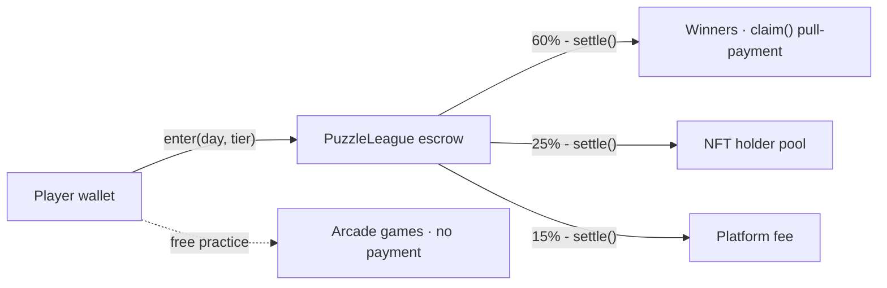
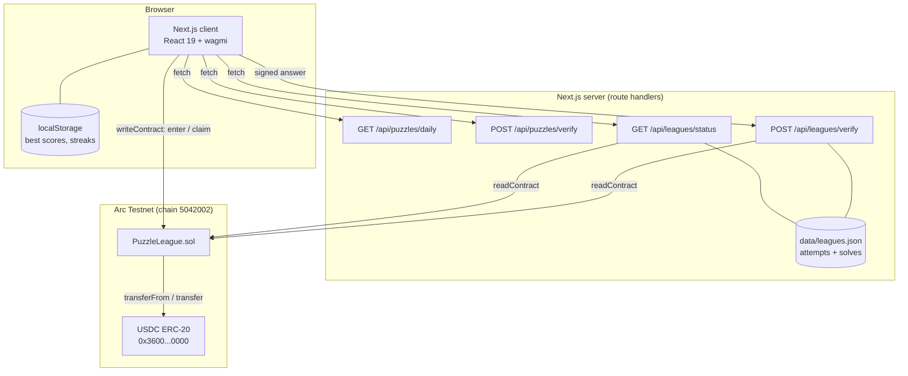
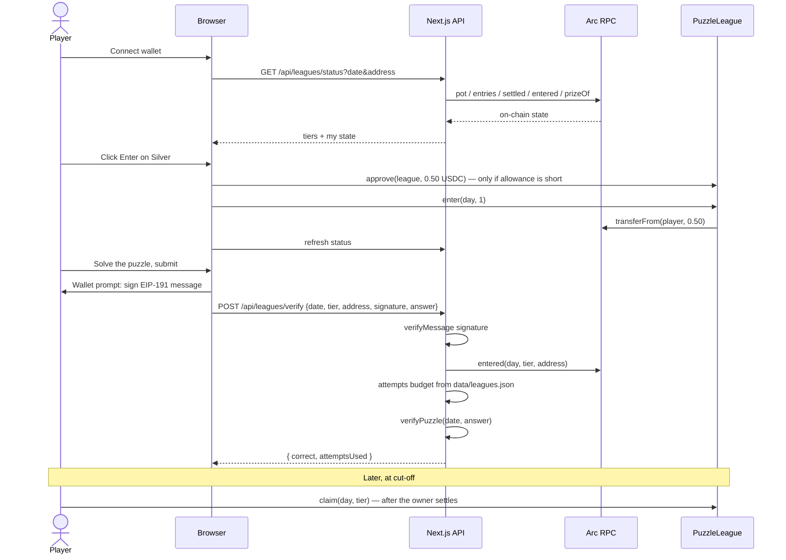

> **Archived.** This document describes the retired plan: our own USDC rails, a 25%
> NFT holder share and a 15% platform take, on Arc Testnet, with four cabinets
> including Bubble Pop. None of it is current, and none of it is built.
>
> The product direction now is in the [README](../../README.md): three games, built to
> run on Bankroll's rails, taking no cut of game revenue.

# ARC-ADE — Engineering Notes

> Internal reference: architecture, contracts, storage, security and conventions.
> The product-facing overview shared with reviewers is `README.md`.

---

## 0. Player accounts (added 2026-11-04)

Players now need a **handle** before any cabinet runs. Postgres is the source of truth;
there is no registry contract yet — that decision is deferred.

**Schema** (`scripts/db-init.mjs`, database `arcade`):

| Table | Purpose |
|---|---|
| `players` | one row per wallet: `address` PK, unique lowercase `username`, lifetime totals |
| `tournaments` | `(game_id, day)` scoped; `status` open → settled |
| `tournament_entries` | who joined which tournament |
| `runs` | one best score per player per tournament |
| `tournament_results` | final placements, written at settlement |

**Registration is signature-only**, no gas: the client signs
`buildRegisterMessage(handle, issuedAt)` (see `lib/account.ts`), the server recovers the
address with `verifyMessage` and rejects anything older than 15 minutes. The handle is
inside the signed message, so a signature can never be replayed to claim a different one.

| Endpoint | Behaviour |
|---|---|
| `POST /api/account/register` | verify signature → insert. 201, 400 invalid, 401 bad sig, 409 taken, 410 expired |
| `GET /api/account/:address` | player card + results + per-game bests, or 404 |

**Handles:** lowercase `a-z0-9_`, 3–16 chars, must start with a letter, reserved words
blocked, globally unique (enforced by the DB constraint, not by a read-then-write check).

**Gating:** `components/require-account.tsx` wraps each cabinet and the daily puzzle.
This is UX only — any endpoint that writes must re-check registration server-side.

**Decisions still open:** points formula, tournament settlement job, whether free play
ever records anything (currently it records nothing; only joined tournaments do).

---


> A skill arcade on Arc. Four deterministic cabinet games and a daily puzzle league.
> Practice free, compete in USDC, and (in a later phase) own a machine of the hall.

This document explains the whole project: what it is, how it is built, how money moves,
what currently works, and what is still only a plan. It reflects the code as it exists
today, not the intended end state.

---

## Table of contents

1. [The idea](#1-the-idea)
2. [The five game modes](#2-the-five-game-modes)
3. [Why the games are fair](#3-why-the-games-are-fair)
4. [How USDC moves](#4-how-usdc-moves)
5. [Architecture](#5-architecture)
6. [Repository layout](#6-repository-layout)
7. [Smart contracts](#7-smart-contracts)
8. [The web app](#8-the-web-app)
9. [The paid league flow, end to end](#9-the-paid-league-flow-end-to-end)
10. [Deterministic generation](#10-deterministic-generation)
11. [Storage and data](#11-storage-and-data)
12. [Configuration](#12-configuration)
13. [Running the project](#13-running-the-project)
14. [Current status](#14-current-status)
15. [Known gaps and inconsistencies](#15-known-gaps-and-inconsistencies)
16. [Security notes](#16-security-notes)
17. [Design system](#17-design-system)
18. [Glossary](#18-glossary)

---

## 1. The idea

Most "play-to-earn" games print a token and hope the token holds value. ARC-ADE
deliberately does the opposite:

- **No game token.** Every prize is USDC that another player actually paid in.
- **No emissions.** There is no inflation mechanism that can collapse.
- **Skill only.** Every board is generated from the UTC date, so all players face the
  identical machine. The only variables are your inputs and your timing.
- **Free practice, always.** Paid entry is optional and never gates the game itself.

The product is a **hall of arcade machines**. You walk in, pick a cabinet, and play.
If you want to compete for money, you put USDC on the round. If you get good enough, you
can end up owning one of the machines itself.

There are two competitive rails that are deliberately kept separate:

| Rail | What you pay for | What decides the winner |
|---|---|---|
| **Arcade rail** (4 cabinets) | A per-round or tournament entry | Your **score** on a seeded board |
| **Puzzle rail** (daily puzzle) | A league entry at one of three tiers | Whether you **solved** the puzzle, in fewest attempts |

Keeping them separate matters: mixing "high score" and "correct answer" into one pot
makes both unfair.

---

## 2. The five game modes

### 2.1 Stack Tower — *Precision & timing*

A block slides left/right; you drop it on the stack. Overlap is preserved, so a sloppy
drop permanently narrows your tower.

- **Scoring:** `1 + bonus + (combo − 1)` per block
- **Special blocks:** `gold` restores width (+14, +5 pts), `bomb` shrinks to ×0.7 width,
  `stone` keeps ≥75% width and is heavy (+2 pts)
- **Combo:** consecutive *perfect* drops build a streak; `combo = min(5, 1 + ⌊streak/3⌋)`,
  any non-perfect drop resets it
- **Milestone:** a "FLOOR n" banner every 20 blocks

### 2.2 Brick Blitz — *Waves, survival & power-ups*

A paddle breaker with seeded walls, a descending hazard wall, and power-up drops.

- **Aim:** the paddle angle follows the mouse; a ghost line previews the first bounce
  (including banking off the side walls)
- **Bricks:** `normal`, `armored` (3 hp), `steel` (indestructible unless fire is active),
  `gold` (100 pts), `bomb`, `moving` (oscillates), `rainbow` (hue cycles)
- **Power-ups:** `expand`, `multi`, `laser`, `fire`, `slow`, `fast`, `life`
- **Pressure:** a hazard wall creeps down continuously; clearing the wall advances to a
  harder seeded wave
- **Speed ramp:** ball speed grows by 6 px/s per brick destroyed, capped at +320

### 2.3 Bubble Pop — *Efficiency & chain reactions*

A hex-grid bubble shooter with a rising tide and a limited shot count.

- **Start:** 46 shots; a dead shot advances the tide
- **Economy:** big clears refund shots (`⌊clearCount / 4⌋`)
- **Combos:** `1 + min(combo, 4)` multiplier
- **Specials:** `ice` (2 hp, cracks first), `stone` (never matches), `bomb` (blast radius
  ≈ 3.2 bubble radii), `gold` (+150 each), `rainbow` (wildcard)
- **Game over:** out of shots, *or* the tide overtakes a bubble
- **Assist:** an optional oscillating aim sweep, toggleable in the HUD

### 2.4 Neon Pinball — *Momentum, physics & combo mastery*

A real physics table, not a pseudo-physics animation.

- **Simulation:** fixed 240 Hz substeps (4.166 ms), so results are identical everywhere
- **Model:** restitution + Coulomb friction with ball-spin coupling
  (`Jt = −vt/3.5`, capped at `μ|Jn|`; `Δω = Jt / (0.4r)`); flippers inject energy through
  `ω × r` contact velocity
- **Table:** 9 wall segments including a lane wall and a one-way gate, 2 slingshot
  kickers (e = 0.95), 3 pop bumpers, 6 drop targets (light all six for the jackpot),
  3 colored kicker triangles, plunger with hold-to-charge
- **Anti-stall:** a ball-search nudge after 3 s of near-zero movement

### 2.5 Daily Puzzle — *the puzzle rail*

One puzzle per UTC day, one of three types, rotated by a date hash:

| Type | Rule | Attempts |
|---|---|---|
| `word` — Daily Anagram | Unscramble the letters | 5 |
| `math24` — Make 24 | Use each number once with `+ − × ÷` | 10 |
| `sequence` — What Comes Next? | Find the next term | 3 |

Answers are generated and checked **server-side**. The public puzzle payload contains no
answer material — only the scrambled letters, the numbers, or the terms.

---

## 3. Why the games are fair

Every piece of a board is derived from a string, never from randomness:

```ts
createDailyRng(dateKey, salt)   // mulberry32(hashSeed(`${dateKey}:${salt}`))
```

So on any given date:

- Stack Tower's block sequence, directions, and speeds are fixed
- Brick Blitz's wall layout is fixed per `date + wave`
- Bubble Pop's board and queue are fixed
- Neon Pinball's table geometry is static, and the physics is deterministic

Two players on the same day are playing literally the same machine. That is what makes a
leaderboard meaningful and what lets a score be compared across wallets.

The tradeoff is that a player *can* memorise a good day's board. This is accepted — the
alternative (per-player randomization) makes scores incomparable, which is worse for a
competitive product.

---

## 4. How USDC moves

There are three rails. Only the first two are wired to a contract today.

| Rail | Entry | Split |
|---|---|---|
| **Per-round play** | 0.10 USDC | 60% prize reserve · 25% NFT holders · 15% platform |
| **Tournament entry** | 0.10 USDC | 60% prize pool · 25% NFT holders · 15% platform |
| **Puzzle leagues** | 0.10 / 0.50 / 1.00 USDC | 60% winners · 25% League Seats · 15% platform |

The puzzle league tiers are named **Copper**, **Silver**, and **Gold**, and are the only
rail with a deployed contract path today.



Key properties:

- **Nothing is printed.** Every unit in the pot came from an `enter()` call.
- **Rounding dust stays in the contract** — it is never minted or redirected.
- **Winners pull their own money** (`claim()`). Settlement never loops over payouts, so a
  single bad recipient cannot block everyone else.
- **Splits are published and on-chain.** Anyone can read `prizeOf()` and verify.

---

## 5. Architecture



The important consequence: **the browser is never trusted** for anything that costs money.
Game scores live in the browser (fine for free play). Paid verification requires an EIP-191
signature plus a live on-chain `entered()` check.

---

## 6. Repository layout

```
games/
├── README.md                            ← this file
├── Platform-Docs.txt                    plain-text export of the /docs page
├── Arcade-Economy-and-NFT-Game-Theory.md  strategy: season scoring, NFT game theory
├── Games-Business-Plan.md               original business plan (older money model)
├── Landing-Neon-Arcade-Hall.md          landing page spec
│
├── contracts/                           Foundry · solc 0.8.20 · evm shanghai
│   ├── foundry.toml
│   ├── src/
│   │   ├── PuzzleLeague.sol             escrow, tiers, settle, claim
│   │   └── MockUSDC.sol                 test-only 6-decimal token
│   ├── script/Deploy.s.sol
│   └── test/PuzzleLeague.t.sol          13 tests
│
└── web/                                 Next 16.3.3 · React 19 · Tailwind v4
    ├── app/
    │   ├── page.tsx                     the hall (landing)
    │   ├── games/{pinball,brick-blitz,bubble-pop,stack-tower}/page.tsx
    │   ├── play/                        daily puzzle + paid leagues
    │   ├── profile/                     wallet, balance, personal bests
    │   ├── docs/                        product documentation page
    │   ├── api/puzzles/{daily,verify}/route.ts
    │   ├── api/leagues/{status,verify}/route.ts
    │   ├── layout.tsx                   fonts + metadata
    │   ├── globals.css                  design tokens + 3D chrome
    │   ├── not-found.tsx · loading.tsx · icon.svg · opengraph-image.tsx
    ├── components/
    │   ├── brand/arcade-logo.tsx        pixel wordmark + robot mark
    │   ├── games/                       4 canvas games + cabinet marquee
    │   ├── landing/                     hall sections
    │   ├── daily-puzzle.tsx · league-panel.tsx · connect-wallet.tsx
    ├── lib/
    │   ├── arc.ts                       chain + USDC + read client
    │   ├── leagues.ts                   tiers, ABIs, signature message
    │   ├── web3.ts · wallet.ts
    │   ├── games/{pinball,stack-tower,brick-blitz,bubble-pop}.ts
    │   ├── puzzles/{engine,rng,date,types,word-scramble,sequence,twenty-four,words}.ts
    │   └── server/league-store.ts       JSON ledger
    ├── hooks/use-stats.ts               local streaks
    ├── scripts/
    │   ├── settle-league.mjs            owner settlement CLI
    │   ├── e2e-league-test.mjs          anvil end-to-end
    │   └── gen-brand-svg.mjs            regenerates public/brand/*.svg
    └── data/leagues.json                created at runtime (gitignored)
```

---

## 7. Smart contracts

### 7.1 `PuzzleLeague.sol`

An escrow per `(day, tier)`. Day is the UTC epoch day:
`BigInt(Date.parse(date + "T00:00:00Z") / 86_400_000)`.

**State**

```solidity
address public immutable usdc;
address public owner;          // set in constructor, NOT transferable
address public holderPool;
address public platformFee;

uint256 public constant PRIZE_BPS     = 6_000;  // 60%
uint256 public constant HOLDER_BPS    = 2_500;  // 25%
uint256 public constant PLATFORM_BPS  = 1_500;  // 15%

uint256[3] public entryFees;   // 100_000 / 500_000 / 1_000_000 (6-dec USDC)

mapping(uint256 day => mapping(uint8 tier => LeagueState))                     public leagues;
mapping(uint256 day => mapping(uint8 tier => mapping(address => bool)))        public entered;
mapping(uint256 day => mapping(uint8 tier => mapping(address => uint256)))     public winnings;
```

**API**

| Function | Access | Behaviour |
|---|---|---|
| `enter(day, tier)` | anyone | Rejects if settled or already entered. Sets effects **before** `transferFrom` (CEI). |
| `settle(day, tier, winners[])` | `onlyOwner` | Requires entries > 0, 0 < winners ≤ entries, every winner is an entrant, no duplicates, no zero address. Marks `settled` **before** the two transfers. |
| `claim(day, tier)` | anyone | Zeroes the balance, then transfers (pull-payment). |
| `setSplits(holderPool, platformFee)` | `onlyOwner` | Changes the recipient addresses. |
| `setEntryFee(tier, fee)` | `onlyOwner` | Changes a tier price. |
| `pot` / `entries` / `settled` / `prizeOf` | view | Read surface used by `/api/leagues/status`. |

**Split arithmetic**

```solidity
prizePool     = pot * 6000 / 10000
holderShare   = pot * 2500 / 10000
platformShare = pot - prizePool - holderShare   // dust lands on the platform side
perWinner     = prizePool / winners.length      // equal shares
```

Any remainder of `prizePool / winners.length` stays in the contract. There is a test for
this (`test_DustRemainderStaysInContract`).

**Trust model — read this before enabling paid play**

- Settlement authority is a **single owner key**. No governance, no timelock, no appeal.
- `owner` is set in the constructor and **cannot be transferred or renounced** — there is
  no `transferOwnership`. If the key is lost, the contract can never settle again and
  entry fees are stuck.
- The contract has **no opinion about scores**. It accepts whatever winner list the owner
  supplies (subject to the entrants-only rule). All fairness lives off-chain.

### 7.2 `MockUSDC.sol`

Six decimals, `mint` is **unrestricted** — anyone can mint. This exists only for tests and
local anvil runs. It must never be deployed to anything public.

---

## 8. The web app

### 8.1 Routes

| Route | Type | Purpose |
|---|---|---|
| `/` | static | The hall: hero, four cabinets, tonight's tournament, puzzle teaser, money, NFTs, fairness |
| `/games/pinball` | static | Neon Pinball cabinet |
| `/games/brick-blitz` | static | Brick Blitz cabinet |
| `/games/bubble-pop` | static | Bubble Pop cabinet |
| `/games/stack-tower` | static | Stack Tower cabinet |
| `/play` | static | Daily puzzle + paid league entry |
| `/profile` | static | Connected wallet, USDC balance, per-game bests, disconnect |
| `/docs` | static | Product documentation |
| `/api/puzzles/daily` | dynamic | Today's puzzle (or `?date=`), answer-free |
| `/api/puzzles/verify` | dynamic | Stateless answer check; also the reveal path |
| `/api/leagues/status` | dynamic | On-chain pots, entries, your entry/claim/attempt state |
| `/api/leagues/verify` | dynamic | Signed paid-league answer verification |
| `/icon.svg`, `/opengraph-image` | static | Favicon and 1200×630 social card |

### 8.2 Chains and tokens

| Item | Value |
|---|---|
| Chain | Arc Testnet, ID `5042002` |
| RPC | `https://rpc.testnet.arc.io` (overridable) |
| USDC (ERC-20) | `0x3600000000000000000000000000000000000000`, 6 decimals |
| Client libs | `wagmi` v3 + `viem` v2, `injected()` connector |

### 8.3 Component responsibilities

| Component | Responsibility |
|---|---|
| `hall-hero.tsx` | Hero copy + the four cabinet cards (reads best scores from localStorage) |
| `cabinet-preview.tsx` | A cabinet card with a CSS preview and accent glow |
| `tournament-banner.tsx` | "Tonight" — pot empty-state, countdown, 60/25/15 bar |
| `featured-puzzle.tsx` | Today's puzzle teaser |
| `money-flow.tsx` | The two money rails and how they split |
| `ownership-section.tsx` | Machine NFTs |
| `fairness-section.tsx` | Four tiles answering "why this isn't P2E" |
| `daily-puzzle.tsx` | Fetch → guess → verify → score card, both free and paid paths |
| `league-panel.tsx` | Tier cards: enter / claim / settled state |
| `connect-wallet.tsx` | Connect, show address + balance, link to profile, disconnect |
| `arc-header.tsx` | Sticky nav + mobile menu + chain badge |
| `cabinet-marquee.tsx` | The lit sign above a cabinet |
| `games/*-game.tsx` | The four canvas cabinets (simulation + rendering + HUD) |

---

## 9. The paid league flow, end to end



The signed message is:

```
I-market Games
Verify a league solve

Date: 2026-11-04
Tier: Silver
```

> Note: this message still says **I-market Games**. It is shown in the user's wallet, so it
> should say ARC-ADE. Changing it is a one-line edit in `lib/leagues.ts`.

**Settlement** is a CLI, not a web endpoint:

```bash
node scripts/settle-league.mjs <date> <tier>            # dry run
node scripts/settle-league.mjs <date> <tier> --execute  # broadcast
```

It reads `data/leagues.json` for the solve list, sorts by attempt count, and calls
`settle()`. It needs `PRIVATE_KEY` (the contract owner) and `LEAGUE_ADDRESS`.

---

## 10. Deterministic generation

`lib/puzzles/rng.ts` provides the whole randomness story:

```ts
hashSeed(str)               // FNV-style 32-bit hash
mulberry32(seed)            // tiny PRNG
createDailyRng(date, salt)  // = mulberry32(hashSeed(`${date}:${salt}`))
pickIndex(rng, length)      // uniform index
shuffle(arr, rng)           // Fisher–Yates, non-mutating
```

Each game uses its own salt so the streams are independent:

| Game | Call | Salt |
|---|---|---|
| Stack Tower | `createDailyRng(dateKey, "stack-tower")` | `stack-tower` |
| Brick Blitz | `createDailyRng(dateKey + ":" + wave, "brick-blitz")` | `brick-blitz` |
| Bubble Pop | `createDailyRng(dateKey, "bubble-pop")` | `bubble-pop` |
| Puzzle type | `hashSeed(date + ":type") % 3` | `type` |

**Invariant to preserve:** never introduce `Math.random()` into board generation. It would
silently break every leaderboard.

---

## 11. Storage and data

### 11.1 Browser (free mode)

| Key | Contents |
|---|---|
| `imarket:stack-tower:best` | all-time best score |
| `imarket:stack-tower:daily` | best score today (keyed by seed) |
| `imarket:stack-tower:perfect` | perfect-run flag for today |
| `imarket:brick-blitz:best` / `:daily` / `:perfect` | same pattern |
| `imarket:bubble-pop:best` / `:daily` / `:perfect` | same pattern |
| `imarket:pinball:best` | all-time best (no daily/perfect keys) |
| `imarket-games:stats:v1` | puzzle solve history → current streak, best streak, total solved |

These keys are prefixed `imarket` for historical reasons. Renaming them would wipe
existing players' records, so they are intentionally left alone.

### 11.2 Server

`web/data/leagues.json`, managed by `lib/server/league-store.ts`:

```json
{
  "2026-11-04": {
    "1": {
      "attempts": { "0xabc...": 2 },
      "solves": ["0xabc..."]
    }
  }
}
```

The whole file is read and rewritten on every operation. There is no locking and no
transaction. This is an MVP: it loses writes under concurrency and does not survive an
ephemeral filesystem. It must be replaced with a real database before paid play scales.

---

## 12. Configuration

Create `web/.env.local` (only `.env.example` is committed):

| Variable | Required | Default | Purpose |
|---|---|---|---|
| `NEXT_PUBLIC_ARC_RPC_URL` | no | `https://rpc.testnet.arc.io` | Arc RPC endpoint |
| `NEXT_PUBLIC_USDC_ADDRESS` | no | `0x3600...0000` | Override for anvil E2E runs |
| `NEXT_PUBLIC_LEAGUE_ADDRESS` | **yes for paid** | empty | Deployed `PuzzleLeague` address |
| `NEXT_PUBLIC_SITE_URL` | no | `http://localhost:3000` | Used for OG metadata resolution |
| `PRIVATE_KEY` | settle only | — | Owner key for `scripts/settle-league.mjs` |
| `LEAGUE_ADDRESS` | settle only | — | Same contract, for the CLI |

When `NEXT_PUBLIC_LEAGUE_ADDRESS` is empty, `leagueDeployed` is `false` and the UI
gracefully degrades — "League contract not deployed yet", "Connect your wallet to join
paid leagues". Free play is completely unaffected.

---

## 13. Running the project

### Contracts

```bash
cd games/contracts
forge build
forge test                      # 13 tests

# deploy to Arc Testnet (all flags BEFORE --constructor args style)
forge script script/Deploy.s.sol \
  --rpc-url $ARC_RPC_URL --private-key $PRIVATE_KEY --broadcast \
  --sig "run(address,address,address)" \
  <USDC> <HOLDER_POOL> <PLATFORM_FEE>
```

### Web

```bash
cd games/web
npm install
npm run dev                     # development, hot reload
npm run build && npm run start  # production
npm run lint
npm run settle -- <date> <tier> [--execute]
npm run e2e:league
```

> **Gotcha:** `next start` serves whatever is in `.next` at boot. After editing source you
> must rebuild *and* restart the server, or you will be looking at stale markup and
> `500`s on `_next/static/chunks/*`. Also note a listener on `:3000` can be IPv6-only
> (`[::1]:3000`) and invisible to `Get-NetTCPConnection` — use `netstat -ano | findstr :3000`.

### Local end-to-end league test

1. `anvil`
2. Deploy `MockUSDC` and `PuzzleLeague`
3. Start the web app with `NEXT_PUBLIC_ARC_RPC_URL=http://localhost:8545` plus the two
   deployed addresses
4. `node scripts/e2e-league-test.mjs` (needs `PLAYER_PK` / `OWNER_PK`)
5. Delete `web/data/leagues.json` afterwards

---

## 14. Current status

**Working today (free mode — fully playable):**

- All four cabinet games, deterministic and identical for every player
- Daily puzzle with server-side answer checking and attempts
- Streaks, personal bests, profile page
- Brand/design system, all pages, 404, OG image
- Contracts: 13/13 tests pass
- `npm run build` green, `tsc` clean

**Blocked on configuration:**

- Paid leagues — no `NEXT_PUBLIC_LEAGUE_ADDRESS`, and the contract has never been deployed
  (there is no `contracts/broadcast/` directory)

**Not built at all:**

- Season points / leaderboard
- Whitelist snapshot (top 1,000 + 1,001–1,500 reserve)
- Machine NFT contract and mint
- Any server-side **score** submission or verification for the arcade games

---

## 15. Known gaps and inconsistencies

These are real and worth deciding on before the next round of changes.

### 15.1 Three money models are on screen at once

| Surface | What it says |
|---|---|
| `components/landing/money-flow.tsx` | "0.10 USDC — **50% → NFT holders**, Remainder **TBD**"; "Daily tournament **1.00 USDC** — 60% winner · **20% team** · **20% NFT holders**" |
| `components/landing/ownership-section.tsx` | "**50%** of every paid round fee"; "**20%** of daily tournament pots"; "5,000 machines" |
| `/docs` page, `Platform-Docs.txt`, `PuzzleLeague.sol` | **60/25/15**, 0.10 entries, tiers 0.10/0.50/1.00 |

The landing page is still selling the old model. The contract and docs agree; the landing
does not.

### 15.2 "50% / 25% / 15% for 1st / 2nd / 3rd" is not implemented

The docs describe a weighted rank payout inside the 60% prize pool. The contract does:

```solidity
uint256 per = s.prizePool / winners.length;   // equal shares
```

So multiple winners are supported, but **weighted ranks are not**. Those percentages also
sum to 90%, not 100% — the remaining 10% is unaccounted for.

### 15.3 Documented but unbuilt

The `/docs` page presents season points, a top-1,000 whitelist, and machine NFTs as part of
the plan. There is no leaderboard API, no score submission, no snapshot job, and no NFT
contract. The strategy doc (`Arcade-Economy-and-NFT-Game-Theory.md`) states that
*"the Smart Contract on ARC chain is the authoritative ledger for all points, scores, and
season data"* — today, scores live only in `localStorage`.

### 15.4 Stale branding

- `components/daily-puzzle.tsx` — share text says "I-market Games"
- `lib/leagues.ts` — the **signature message** says "I-market Games" (visible in the wallet
  prompt)
- `imarket:*` storage keys (deliberately kept — renaming wipes player data)

### 15.5 Style drift

`/docs` is the only page still on the pre-rebrand steel-blue `rounded-xl` treatment; every
other surface uses the black/cyan/violet pixel system.

### 15.6 Dead code

`components/landing/`: `live-stats.tsx`, `activity-feed.tsx`, `how-it-works.tsx`,
`split-donut.tsx`, `particle-background.tsx` are imported nowhere.

### 15.7 Hygiene

- `web/.git` has a single commit ("Initial commit from Create Next App"); all real work is
  uncommitted
- `games/` and `contracts/` are not under version control
- `contracts/out/` and `contracts/cache/` are build artifacts sitting in the tree
- Lint reports 46 problems (33 errors), concentrated in `react-hooks/refs` (14) and
  `set-state-in-effect` (8) inside the canvas game components

---

## 16. Security notes

### 16.1 Answer reveal bypass — **fix before enabling paid leagues**

`POST /api/puzzles/verify { reveal: true }` returns the answer for **any date**,
unauthenticated and unthrottled:

```ts
if (reveal) {
  return { correct: false, message: "Answer revealed.", revealAnswer: solution };
}
```

The daily puzzle used by the paid league is *the same puzzle*. A player can enter a tier,
call the free reveal endpoint, and submit the answer to `/api/leagues/verify` for a
guaranteed win. The UI's guard (`if (paid) return`) is client-side only.

**Suggested fixes** — pick one:
- Refuse `reveal` for the current UTC date entirely, or
- Refuse `reveal` on any date where the caller has a live paid entry, or
- Only allow reveal after the day has closed (date < today)

### 16.2 Settlement is a single trusted key

`settle()` is `onlyOwner` and the winner list comes from a JSON file. Compromise of that
key redirects 60% of every pot. There is no timelock, no dispute window, and ownership
cannot be transferred or renounced.

### 16.3 No arcade score verification

The four games never submit a score anywhere. The paid puzzle rail verifies an *answer*;
the arcade rail has no equivalent path. Any arcade tournament today would have to trust the
browser.

### 16.4 Free-path brute force

`/api/puzzles/verify` has no rate limit. A short word answer could be guessed by
enumeration. Cheap to fix with a per-IP counter.

### 16.5 JSON ledger

Unlocked read-modify-write; loses updates under concurrency and resets on ephemeral hosts.

### 16.6 `MockUSDC.mint`

Unrestricted. Test-only. Never deploy publicly.

---

## 17. Design system

Quick reference so new work stays consistent.

### Palette

| Token | Value | Use |
|---|---|---|
| `--arcade-cyan` | `#22e0ff` | brand accent, primary |
| `--arcade-violet` | `#8b5cf6` | brand accent, secondary |
| `--arcade-gradient` | cyan → violet | the underscore bar, buttons, borders |
| `--arcade-steel` | `#5b9fd8` | **machines only** — never chrome |

### Type

| Token | Font | Use |
|---|---|---|
| `font-heading` | **Press Start 2P** | panel and card titles, big read-outs |
| `font-display` | **Silkscreen** | nav, marquee, eyebrows, buttons, HUD numerals |
| `font-sans` (default) | **Chakra Petch** | body copy |

### 3D chrome

One shading recipe everywhere: light bevel top-left, dark bevel bottom-right, hard
**no-blur** drop.

| Class | Effect |
|---|---|
| `.pixel-panel` | raised box / frame |
| `.pixel-card` | raised sub-card |
| `.pixel-well` | recessed — inputs, puzzle tiles, HUD read-outs |
| `.pixel-raise` | bevel only, for elements with their own background |
| `.arcade-btn` / `-ghost` / `-sm` / `-chip` | raised control; hover lifts 2 px, click sinks 4 px |

### Brand marks

`components/brand/arcade-logo.tsx` exports `RobotMark` (pentagon head, antenna, cyan eyes)
and `ArcadeWordmark` (`ARC` + gradient underscore + robot-A + `DE`). Both are transparent
inline SVG on a 7×9 pixel grid with `shapeRendering="crispEdges"`. Shareable copies live in
`public/brand/`, regenerated with `node scripts/gen-brand-svg.mjs`.

---

## 18. Glossary

| Term | Meaning |
|---|---|
| **Cabinet / machine** | A playable game. "Machine" is also the NFT type tied to a game. |
| **Seed / daily seed** | The UTC date string that deterministically generates a board. |
| **Tier** | Paid puzzle-league price band: Copper 0.10, Silver 0.50, Gold 1.00 USDC. |
| **Rail** | A separate money path. Arcade rail and puzzle rail never mix. |
| **Settle** | Owner call that closes a league, assigns winnings, and distributes the 25% / 15%. |
| **Claim** | Player call that pulls their assigned winnings. |
| **Dust** | Rounding remainder left in the contract after division. |
| **League day** | UTC epoch day, `Date.parse(date + "T00:00:00Z") / 86_400_000`. |
| **Attempt budget** | Server-tracked guesses per date + tier + address (5 / 10 / 3 by puzzle type). |

---

*Last reviewed: 2026-11-04.*
