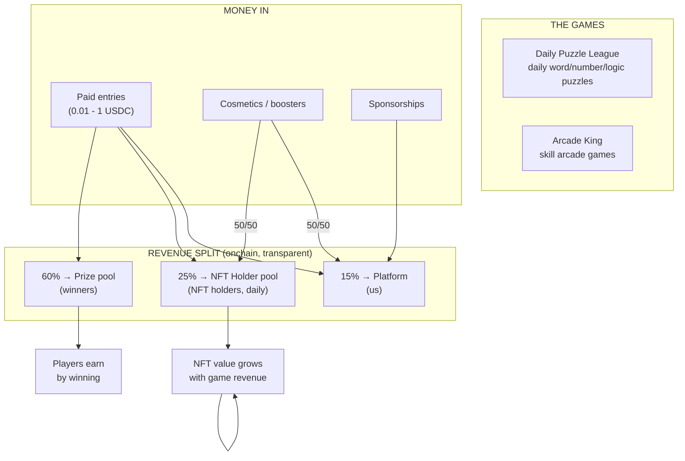
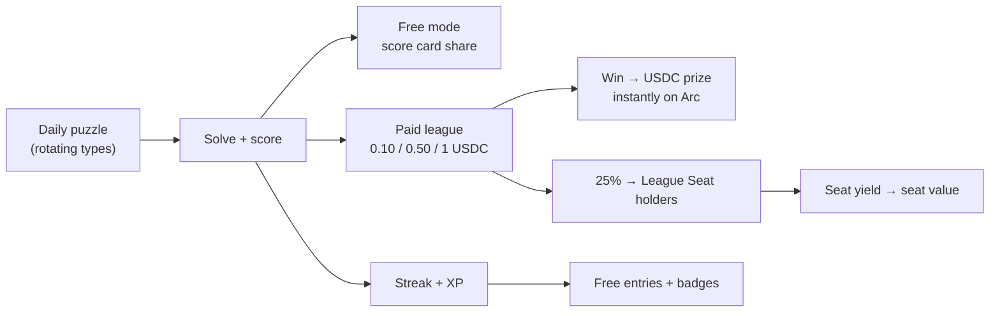
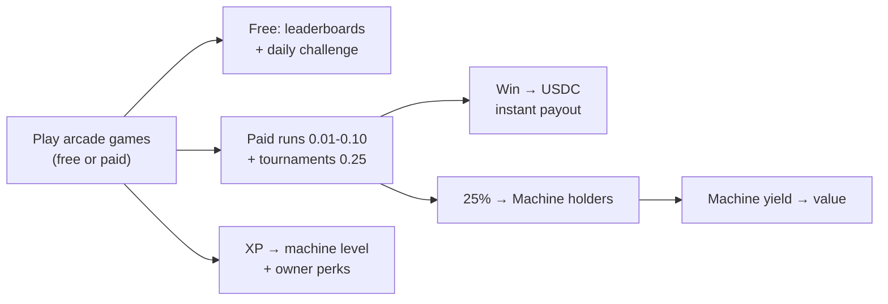
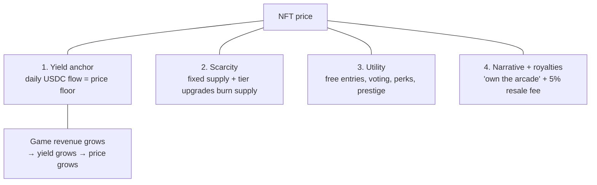

> **In development.** The business model is not decided. Nothing below is a commitment.
> Current product direction: [README](../../README.md).

# I-market Games — Full Project Design

> Two computer-only, revenue-generating games on Arc: **Daily Puzzle League** and **Arcade King**.
> Status: design phase (no code yet) · Part of the I-market project family

---

## 1. The Idea in One Picture

Two simple games where **playing generates real USDC revenue**, and that revenue flows to **players (prizes), NFT holders (passive income), and us (rake)**. Nothing is printed from thin air — every USDC paid out came from a USDC paid in.

**Why this works when every P2E game died:** rewards are backed by real game revenue, denominated in **USDC (stable dollars)**, settled **instantly on Arc**. The NFT is a **revenue claim** — "own part of the arcade" — not a speculative jpeg.

---

## 2. The Shared Revenue Engine

| Source | Prize pool | NFT Holder pool | Platform (us) |
|---|---|---|---|
| Tournament entries (1 USDC) | 60% | 20% | 20% |
| Per-round play fee (0.10 USDC) | — | **50%** | split TBD |
| Cosmetics / boosters | — | 50% | 50% |
| Sponsorships | varies (quests) | — | majority |

- **Every revenue stream is shared.** Per-round fees send 50% directly to NFT holders; the remaining share ratio is decided later.
- An **account page** will show each holder their accumulated, claimable USDC from the holder pools.
- Everything settles in **USDC on Arc**: instant, sub-second, auditable onchain.
- Unclaimed winnings earn yield via **EarnKit** while they wait.
- Fee cost per transaction ~$0.004 — micro-entries (0.01 USDC) stay profitable.

---

# 🧩 Game 1 — Daily Puzzle League

## Gameplay

- **One puzzle per day, same for everyone.** Resets at midnight UTC.
- **Mixed puzzle types, rotating daily** *(locked decision — mixture keeps it fresh, never boring)*:
  - 🔤 **Word days** — Wordle-style word guessing
  - 🔢 **Number days** — math/number-sequence riddles (Nerdle-style)
  - 🧠 **Logic days** — pattern/logic grid puzzles
- **Free mode:** everyone plays free → score + shareable score card (Wordle-style virality).
- **Paid leagues** (optional):

| League | Entry | Prize split (top N) |
|---|---|---|
| Copper | 0.10 USDC | 60 / 25 / 15 |
| Silver | 0.50 USDC | same, deeper payout curve |
| Gold | 1.00 USDC | same + weekly champion bonus |

- **Streaks & XP:** solve streaks → XP → free entries, badges, entry discounts.
- **Weekly Championship:** top solvers of the week play a harder puzzle for the accumulated bonus pool.
- **Referrals:** invite a friend who enters → 5% of their first entry (paid from our 15%, never the prize pool).

## How Users Make Money

1. **Winning leagues** — the direct prize, paid instantly in USDC
2. **Streaks → free entries** — consistency converts into free shots at prizes
3. **Referrals** — small % of friends' entries
4. **Sponsor quests** — brands sponsor puzzle days; quests pay micro-USDC to solvers

## How We Make Money

- 15% of every league entry (pure rake, zero inventory cost)
- 50% of badge/cosmetic sales
- Sponsorship packages ("Today's puzzle brought to you by Brand X")

## The NFT — **League Seat** *(collection 1)*

- **Fixed supply: 10,000 seats. Ever.**
- Each seat = **1/10,000 of the daily Holder pool** (25% of entries + 50% of cosmetics).
- **Tiers:**
  - 🥉 **Bronze** — standard share
  - 🥈 **Silver** — 2× share + 1 free league entry/day
  - 🥇 **Gold** — 5× share + free gold-league entry + vote on future puzzle themes
- **Upgrading** = burning Bronze/Silver seats → supply shrinks over time → scarcity grows.
- **Secondary market royalty:** 5% of every resale → to us.

### Illustrative economics

| Daily league entries | Entry volume/day | Holder pool/day | Per-seat yield/yr | Implied seat value (at 10× yield) |
|---|---|---|---|---|
| 1,000 | 100 USDC | 25 USDC | ~0.91 USDC | ~9 USDC |
| 10,000 | 1,000 USDC | 250 USDC | ~9.1 USDC | ~91 USDC |
| 100,000 | 10,000 USDC | 2,500 USDC | ~91 USDC | ~910 USDC |

---

# 🕹️ Game 2 — Arcade King

## Gameplay

- **The arcade hall:** the main page is a game hall — players pick a machine and play.
- **Account model:** players charge their account with USDC on Arc. Before each round, **0.10 USDC is deducted** automatically from the account.
- **Three launch machines:** Stack Tower (timing), Brick Blitz (paddle), Bubble Pop (aim) — all with seeded boards so every tournament player faces the identical game.
- **Free practice mode:** unlimited, no fee, not tournament-eligible — the on-ramp to every machine.
- **Daily tournament:** pay **1 USDC**, play for your best score; the highest score at the 24h cutoff wins. Split: **60% winner / 20% team / 20% NFT holders**. One per machine.
- **Later:** H2H brackets, weekly Grand Prix, skill bands.

## How Users Make Money

1. **Daily tournaments** — best score in 24h takes 60% of the pot
2. **Paid runs** — skill → cash, settled instantly
3. **Daily leaderboard prizes** — top free-mode scores get small USDC from a sponsor pool
4. **Streak bonuses** — play 7 days straight → bonus entry credit
5. **Holding a Machine NFT** — passive rake share (50% of every round fee + 20% of tournament pots)

## How We Make Money

- 20% of tournament pots + the platform share of per-round fees (TBD) + 50% of cosmetics/boosters + 5% NFT resale royalties
- Tournament sponsorships ("Brand X Grand Prix")
- **Later:** game-developer revenue share — third-party devs build mini-games on our arcade (Skillz's developer model)

## The NFT — **Arcade Machine** *(collection 2)*

- **Fixed supply: 5,000 machines.** Each machine = **1/5,000 of the Holder pool** (50% of every per-round fee + 20% of tournament pots + 50% of cosmetic revenue).
- **Account page:** holders see their accumulated claimable USDC from the holder pool in real time.
- **Machine level:** every game played in the arcade earns XP for the machine hosting the "lobby" — machines level up → owner perks (free daily entries, nameplate on leaderboards). Leveling = *visible growth* of the asset.
- **Rare variants:** limited-edition skins (e.g., 1/50 gold-plated, 3× share) as tournament prizes.
- **Own-the-casino narrative:** "I own machine #0421 — it pays me every day because people are playing."

### Illustrative economics

| Daily paid runs | Volume/day | Holder pool/day | Per-machine yield/yr | Implied machine value (at 10×) |
|---|---|---|---|---|
| 5,000 | 250 USDC | 62.5 USDC | ~4.6 USDC | ~46 USDC |
| 50,000 | 2,500 USDC | 625 USDC | ~46 USDC | ~456 USDC |
| 500,000 | 25,000 USDC | 6,250 USDC | ~456 USDC | ~4,560 USDC |

---

## 3. Why the NFTs Stay Valuable (the four pillars)

The NFT price is anchored to **fundamental revenue**, not hope — the exact thing every dead P2E project lacked.

## 4. Why Arc

| Need | Arc provides |
|---|---|
| Stable rewards | USDC — no token death spiral |
| Instant payout feedback | Sub-second finality |
| Micro-entries viable | ~$0.004 avg fee, 18-decimal precision |
| Idle rewards earn | EarnKit yield on unclaimed winnings |
| Transparent split | Onchain, verifiable by anyone |

## 5. Fairness & Anti-Abuse

- Server-side score verification; anti-bot captchas on paid entries
- One entry per wallet per league; skill-band matching (Skillz model)
- Free tier always available; payouts only from entry fees (never our treasury)
- Prize pools are onchain and auditable

## 6. Legal Notes (flagged, not blocking)

- Paid skill-game entries are regulated differently by jurisdiction (skill vs. chance vs. lottery).
- Design stays on the right side: free tier always, payouts based on skill, prize pools capped by entry fees.
- Full legal review before launch in each target region.

## 7. Build Order (recommended)

| # | Step | Time |
|---|---|---|
| 1 | **Daily Puzzle League MVP** — daily mixed puzzles, free mode + Copper league, League Seats | ~2–3 weeks |
| 2 | Add Silver/Gold leagues, streaks, referrals, sponsor quests | +2 weeks |
| 3 | **Arcade King** — flagship game + paid runs + Machine NFTs | +6–8 weeks |
| 4 | Mini-games, Grand Prix, developer revenue share | later |

## 8. Locked Decisions

| # | Decision |
|---|---|
| 1 | Puzzle types: **mixed rotation** — word / number / logic *(less boring)* |
| 2 | **One NFT collection per project** — League Seats (puzzle) + Arcade Machines (arcade) |
| 3 | Initial NFT supply size — **pending discussion with colleagues** |
| 4 | Launch machines: **Stack Tower, Brick Blitz, Bubble Pop** |
| 5 | Per-round fee **0.10 USDC**; **50% goes directly to NFT holders** (remaining split TBD) |
| 6 | Daily tournament: **1 USDC entry, best score wins at the 24h cutoff**; split **60/20/20** |
| 7 | Main page = **game hall** (choose your machine) |

## 9. Open Questions

1. Initial League Seat supply: 1,000 (scarce start) or 10,000 (broad start)?
2. Remaining per-round fee share (after 50% to holders): platform vs. prize pool?
3. Account/charge UX: direct wallet transfers or smart-account escrow?
4. Launch target: before Arc mainnet (Sept 16) or after?

## 10. Development Steps (ordered)

### Stage A — Foundations (week 1)
1. Repo + tooling: web app (Next.js or Vite) + backend (Node/TS) + DB + `.env`.
2. Arc integration: viem/wagmi with `arcTestnet`, wallet connect, USDC pay/balance flows on testnet.
3. Circle Console: API key + entity secret; dev-controlled wallet; faucet USDC for testing.

### Stage B — Puzzle engine (week 1–2)
4. Generate daily puzzles: word (Wordle-style), number (Nerdle-style), logic — rotating schedule.
5. Server-side answer verification + daily reset + score computation.
6. Free mode: play UI, shareable score card, streaks + XP storage.

### Stage C — Paid leagues + settlement (week 2–3)
7. League engine: Copper (0.10 USDC) entry → pool → winner payout; 60/25/15 split logic.
8. Payouts onchain (USDC) + holder-pool accumulator (to be distributed later).
9. Anti-abuse: one entry per wallet, captcha, rate limits.

### Stage D — League Seat NFT (week 3)
10. ERC-721 collection (fixed supply TBD w/ colleagues) + tier system (Bronze/Silver/Gold).
11. Holder-pool distribution script (daily pro-rata, claimable).
12. Mint page + allowlist campaign; 5% resale royalty.

### Stage E — Launch Puzzle League MVP (week 4)
13. Deploy on Render; connect marketing: Moltbook agent, Arc House, X.
14. Launch: mint + first daily puzzle + Copper league live.

### Stage F — v1.5 (weeks 5–6)
15. Silver/Gold leagues, weekly championship, referrals (5%), sponsor quests.

### Stage G — Arcade King (weeks 7–13)
16. Game hall main page (machine tiles, balance, tournament cards).
17. Machine 1: **Stack Tower** — canvas game, daily seeded board, free practice mode.
18. Machine 2: **Brick Blitz**; Machine 3: **Bubble Pop**.
19. Fee engine: 0.10 USDC per round, 50% → holder pool (reuses the league contract pattern).
20. Daily tournaments: 1 USDC entry, best score in 24h, 60/20/20 (reuses PuzzleLeague settle flow).
21. Account page: balance + holder earnings view.
22. Machine NFT collection (fixed 5,000) + rake-share + XP levels + rare variants.
23. Launch Arcade King; later: H2H brackets, Grand Prix, dev revenue share.

### Cross-cutting (all stages)
- Legal review (skill vs. chance) before enabling paid entries in each region.
- Test on Arc testnet only; audit prize/holder contracts before real money.
- Marketing cadence per the marketing plan (pre-launch teasers → allowlist → Sept 16 timing hook).
